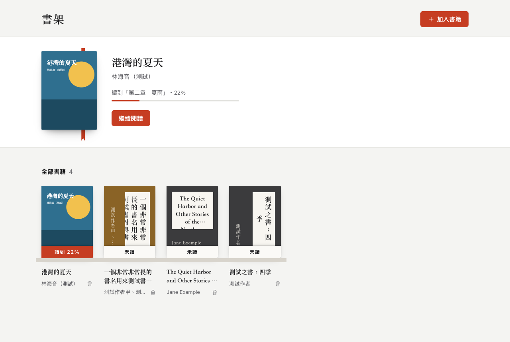

# shiori-reader

在瀏覽器裡讀 EPUB。不需後端、不需帳號，書只存在你的瀏覽器裡。中文直排是一等公民。

A browser-only EPUB reader with first-class CJK vertical text. No server, no account — books stay in your browser.



## 功能

- 匯入：按「加入書籍」選檔，或直接把 .epub 拖進視窗，可一次多本
- 書架依最近閱讀排序，打開就回到上次讀到的地方
- 翻頁：按鈕、方向鍵、點畫面左右兩側、觸控滑動
- 排版：字級、行距、字體（原書／明體／黑體）、底色（白紙／書皮／夜讀）、直排／橫排、分頁／捲動
- 目次
- 介面語言：繁體中文、英文，依瀏覽器語言自動切換；網址加 `?lang=en` 或 `?lang=zh` 可指定

尚未支援：書籤、劃線筆記、全文搜尋、離線使用。

需要支援 Popover API 的瀏覽器（Chrome 114、Safari 17、Firefox 125 以上）。

## 隱私

書和閱讀進度存在瀏覽器的 IndexedDB，不會上傳到任何伺服器。清除網站資料會一併清掉書架。

## 開發

需要 Node 22（見 `.nvmrc`）。

```sh
npm install
npm run dev
```

`npm run build` 輸出到 `dist/`，是純靜態檔案，任何靜態主機都能放。

## 授權

[MIT](LICENSE)

渲染引擎是 [foliate-js](https://github.com/johnfactotum/foliate-js)（MIT），其中隨附 [zip.js](https://github.com/gildas-lormeau/zip.js)（BSD-3-Clause）與 [fflate](https://github.com/101arrowz/fflate)（MIT）。
