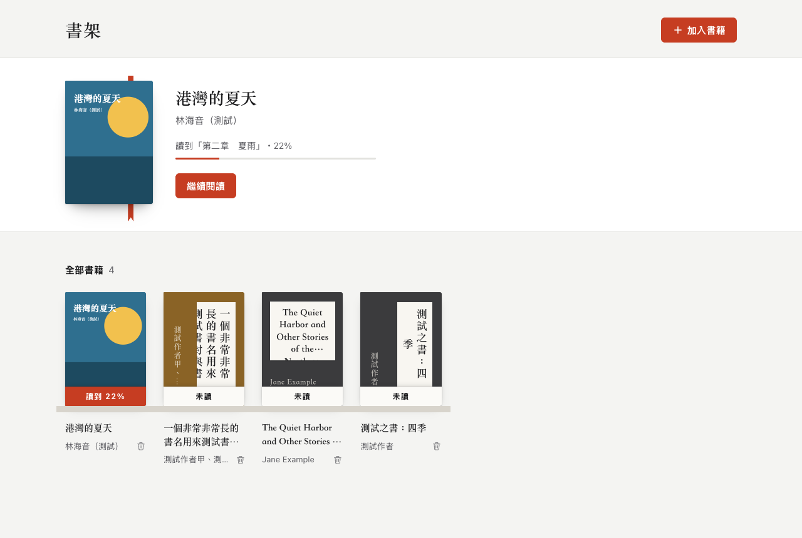

# shiori-reader

[](README.md) [](README.zh-TW.md)

在瀏覽器裡讀 EPUB。不需後端、不需帳號，書不會上傳。中文直排是一等公民。

Demo：https://shiori.josh-hsu.com



## 功能

- 匯入：按「加入書籍」選檔，或直接把電子書（EPUB、MOBI、AZW3、FB2、CBZ）拖進視窗，可一次多本
- 書架是空的時候，可一鍵載入公有領域的範例書
- 書架依最近閱讀排序，打開就回到上次讀到的地方
- 翻頁：按鈕、方向鍵、空白鍵／Page Down、點畫面左右兩側、觸控滑動
- 排版：字級、行距、字體（原書／明體／黑體）、底色（白紙／書皮／夜讀）、直排／橫排、分頁／捲動
- 目次
- 介面語言：繁體中文、簡體中文、日文、英文。預設跟隨瀏覽器語言，可在書架頁的「設定」切換；網址加 `?lang=zh-Hant`、`?lang=zh-Hans`、`?lang=ja` 或 `?lang=en` 也可指定
- 開過一次後可離線使用

尚未支援：書籤、劃線筆記、全文搜尋。

需要支援 Popover API 的瀏覽器（Chrome 114、Safari 17、Firefox 125 以上）。

## 隱私與保存

預設書只放在目前這個分頁：存在記憶體裡、不會上傳，關閉分頁就會清空。

要留著書架，請在書架頁打開「設定」，把「保存」改成「存在這台裝置」。確認之後，書和閱讀進度會存在這台裝置瀏覽器的 IndexedDB。改回「只在這個分頁」會把書從這台裝置移除，一樣會先請你確認。清除網站資料也會一併清掉書架。

底色、排版、語言等設定存在 localStorage。

## 鍵盤

| 按鍵 | 動作 |
| --- | --- |
| ← / → | 依畫面左右翻頁 |
| 空白鍵、Page Down | 下一頁 |
| Shift＋空白鍵、Page Up | 上一頁 |
| Esc | 顯示或收起工具列 |
| Tab | 工具列收起時會先叫出工具列 |

瀏覽器的返回鍵與手機的返回手勢都會回到書架。

## 無障礙

- 所有控制項都能用鍵盤操作，並有清楚的焦點框
- 螢幕閱讀器：按鈕都有標籤，閱讀進度念成百分比，匯入結果與錯誤會主動念出，書名標上書本身的語言
- 第一次開啟時底色跟隨系統的淺色／深色模式；尊重「減少動態效果」與 Windows 高對比設定

遇到使用上的障礙，歡迎開 issue。

## 開發

需要 Node 22（見 `.nvmrc`）。

```sh
npm install
npm run dev
```

`npm run build` 輸出到 `dist/`，是純靜態檔案，任何靜態主機都能放。

`npm test` 檢查翻譯字典；`npm run test:e2e` 用 Chromium 實際操作正式 build（第一次先跑 `npx playwright install chromium`）。

## 授權

[MIT](LICENSE)

渲染引擎是 [foliate-js](https://github.com/johnfactotum/foliate-js)（MIT），其中隨附 [zip.js](https://github.com/gildas-lormeau/zip.js)（BSD-3-Clause）與 [fflate](https://github.com/101arrowz/fflate)（MIT）。

範例書（`public/samples/`）皆為公有領域：

- 魯迅《吶喊》：文字取自[維基文庫](https://zh.wikisource.org/wiki/吶喊)（底本為 1948 年版《魯迅全集》），由本專案排成直排 EPUB
- Arthur Conan Doyle《The Adventures of Sherlock Holmes》：[Standard Ebooks](https://standardebooks.org/ebooks/arthur-conan-doyle/the-adventures-of-sherlock-holmes) 製作，CC0
